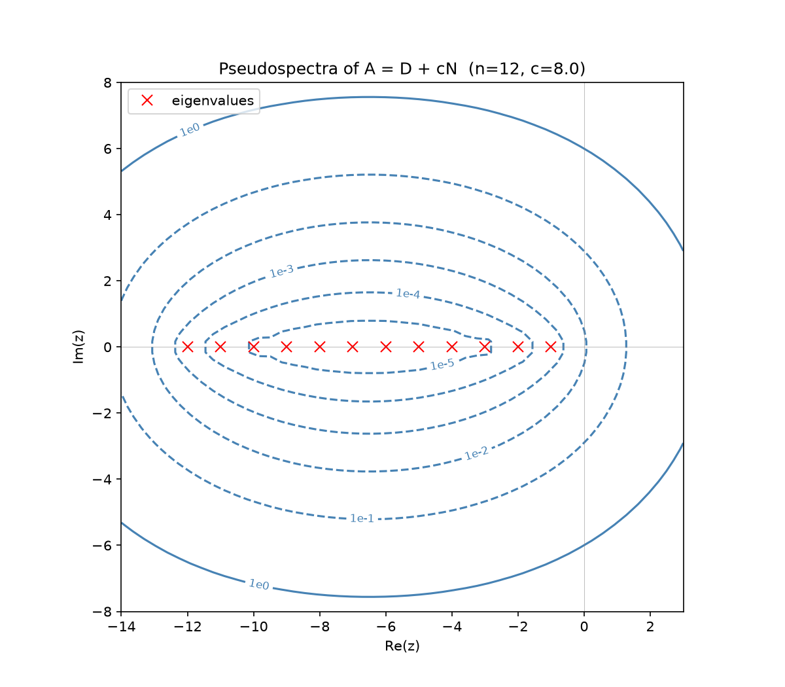
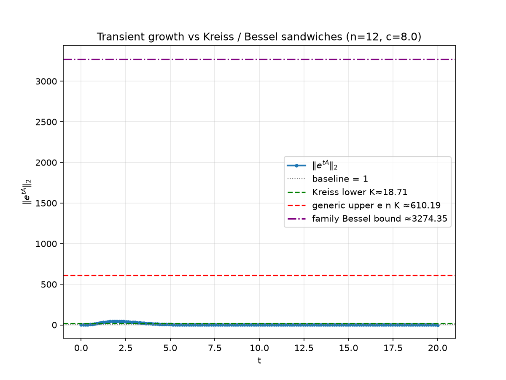

# Pseudospectra and Transient Growth of Non-Normal Matrices

A research toolkit for studying **pseudospectra** — a generalization of
eigenvalues that reveals hidden instability in non-normal matrices — applied
to structured matrix families arising in ODEs and discretized PDEs.

## The phenomenon in one picture

A matrix can have every eigenvalue in the stable left half-plane, and yet
`||exp(tA)||` (the norm of the matrix exponential — governing solutions of
`x' = Ax`) can grow by orders of magnitude before eventually decaying. This
"transient growth" is invisible to eigenvalue analysis alone but is exactly
what pseudospectra are built to detect.

| Eigenvalues say "stable" | But the dynamics disagree |
|---|---|
|  |  |

*(figures generated by `examples/demo.py` for a spectrally-stable, 20x20,
strongly non-normal matrix — peak transient growth of ~45x despite every
eigenvalue having negative real part)*

## Background

For matrix `A`, the epsilon-pseudospectrum is
```
Lambda_eps(A) = { z in C : sigma_min(A - zI) <= eps }
```
For normal matrices this is just eps-disks around eigenvalues. For non-normal
matrices it can be dramatically larger, and its shape controls transient
growth via the Kreiss Matrix Theorem. See `docs/IMPLEMENTATION_PLAN.md` for
full background, references, and the research roadmap.

## Quickstart

```bash
git clone <this-repo>
cd pseudospectra-project
pip install -r requirements.txt
python examples/demo.py          # generates all figures in figures/
python -m pytest tests/ -v       # verify full test suite (95 tests passing)
```

## Repository structure

```
pseudospectra/
  core.py       # grid-based σ_min(A − zI)
  matrices.py   # structured families (headline: shifted superdiagonal)
  bounds.py     # Kreiss constant, transient growth, sandwich bounds
  theory.py     # exact resolvent / exp(tA) and family-specific Bessel bound
  plotting.py   # visualization
examples/demo.py  # reproducible study (`--full` for finer grids)
tests/            # comprehensive test suite (unit + adversarial audit)
docs/             # plan, literature notes, results log, theorem proof
```

## Status / Main Theorem

The numerical pipeline and exact theoretical substrate are complete and verified by 95 unit & adversarial tests.

For the headline family `A = D + c N`, the repository includes the closed-form resolvent, closed-form matrix exponential, interaction-picture factorization, and the sharp two-sided asymptotic peak theorem:

$$ \sup_{t \ge 0} \|e^{tA}\|_2 = \frac{\delta}{e (4\pi)^{1/4}} \left(\frac{c}{\delta}\right)^{-5/4} e^{c/\delta} \left(1 + O\left(\frac{\delta}{c}\right)\right) $$

See `docs/paper_theorem_proof.md` and `docs/results_log.md` for complete derivations and numerical validation tables.

## References

- L.N. Trefethen & M. Embree, *Spectra and Pseudospectra: The Behavior of
  Nonnormal Matrices and Operators*, Princeton University Press, 2005.
- L.N. Trefethen, A.E. Trefethen, S.C. Reddy, T.A. Driscoll, "Hydrodynamic
  Stability Without Eigenvalues," *Science* 261 (1993), 578–584.
- L. Reichel & L.N. Trefethen, "Eigenvalues and pseudo-eigenvalues of
  Toeplitz matrices," *Linear Algebra and its Applications* 162–164 (1992).

## License

MIT License. See [LICENSE](LICENSE) for details.
